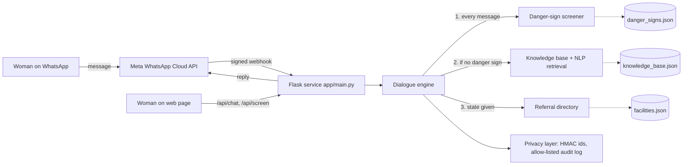

# Architecture

## Request flow
1. A message arrives (WhatsApp webhook or web chat). The sender id is pseudonymized immediately.
2. **Screening runs first** on every free-text message. Emergency/urgent results return advice plus a request for the user's state.
3. Otherwise the conversation state (menu choice, awaiting location) or the knowledge base answers.
4. Only a de-identified event (type, triage level, sign ids, KB id) is written to the audit log.

## Why rules + retrieval instead of a generative model
- **Safety and explainability:** every triage decision lists the exact signs matched, and clinicians can edit the JSON directly.
- **No hallucinated medical advice:** answers come only from reviewed content with a cited source.
- **Low cost:** pure Python, runs on a small VM; no GPU or paid model API.

Machine-learning components planned for later phases (e.g. a classifier trained on de-identified, consented, clinician-labelled messages to suggest new phrases) will be added **only as a suggestion layer**, with the rules engine remaining the final safety net, and will be evaluated on held-out data before deployment.

## Scaling notes
Sessions and rate limits are in memory (single instance). For multiple instances, move them to Redis. Content is loaded at start-up; reload by restarting the service.
